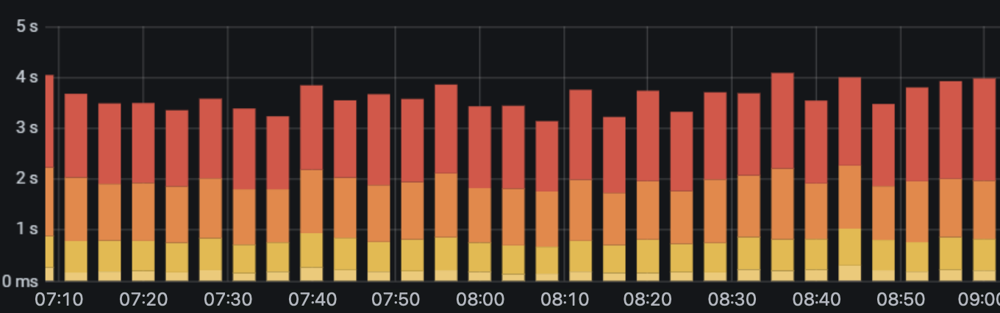

# ShotShifter

Shift the time axis of dashboard screenshots to another time zone.

ShotShifter is a macOS command-line tool that reads time labels in PNG or JPEG screenshots and redraws them with a fixed offset. It targets Grafana but works with other dashboards using [supported label formats](docs/formats-and-limitations.md#supported-label-formats).

|  |  |  |
|:---:|:---:|:---:|
| original screenshot | shotshifter -s -05:00 | shotshifter -s -05:00 -b |

## Disclaimer

This project was 100% vibe coded. All of its code and documentation were generated by Claude Opus 5.5 and GPT-6-Astra. However, the project includes automated unit and end-to-end tests.

The author is not responsible for incorrect results. This includes misread or missed axis labels, incorrect time shifts or time zone labels, altered or overlapping text, and any conclusions drawn from the modified screenshots. Before you act on a screenshot from ShotShifter, for example during an incident investigation, compare the labels that matter against the original screenshot and verify the intended time offset.

The software is provided as is, without warranty of any kind, under the [MIT license](LICENSE).

## Install

Requires macOS 26 or later on Apple Silicon.

```sh
brew install jftuga/tap/shotshifter
```

For release downloads, source builds, and toolchain requirements, see the [installation guide](docs/installation.md).

## Quick start

```sh
shotshifter -s -05:00 graph.png       # Shift back five hours
shotshifter -s +5:30 *.png            # Process multiple screenshots
shotshifter -s -05:00 -b -f graph.png # Overwrite output with review outlines
```

Output is saved beside the input as `graph-shifted.png`. Existing output is skipped unless you add `-f` to overwrite it.

Use `-b` to review shifted labels in green and warnings in red. Compare the result with the original: a green outline does not guarantee correct text recognition. Add `--strict` to skip writing any file that produces a warning; it cannot be combined with `-b`.

Offsets are fixed and do not account for daylight saving changes. Times must use supported 24-hour formats; day-first dates are not supported.

## Documentation

- [Installation](docs/installation.md) — Homebrew, release downloads, and building from source.
- [Usage reference](docs/usage.md) — all options, review outlines, warnings, and exit codes.
- [Supported formats and limitations](docs/formats-and-limitations.md) — date and time labels, time zones, and image processing.
